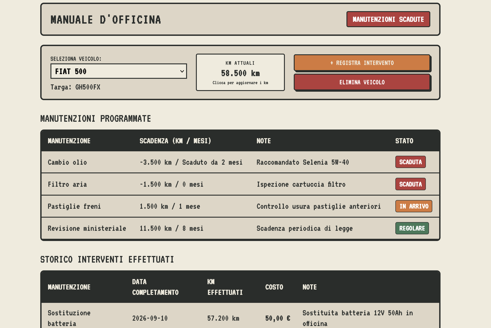

# **Car maintenance app**

Because I've never been good at keeping track of when I last changed the oil or at how many miles I did the last service.

A lightweight, self-hosted web app to track vehicle maintenance, born out of my terrible memory for car upkeep and a desire to build a full-stack project from scratch using Python.



## Motivation and story

I was tired of relying on clunky spreadsheets to track oil changes, service intervals, and car repairs. Spreadsheets work, but they quickly feel tedious, lack a smooth user experience, and don't fit nicely into a mobile-friendly dashboard. I wanted a clean, dedicated application running on my home server—one tailored specifically to my needs.

Beyond replacing spreadsheets, this project was the perfect sandbox to:

- **Level up my Python skills**: Coming from a Data Science background, I wanted to step outside my daily analytical routine and build a complete, production-style web backend from scratch.

- **Bridge the front-end gap with LLMs**: I don’t have a background in front-end development, but I leveraged LLMs as a boost to build a functional, retro-industrial pixel-art interface that turned out way cooler than anything I could have designed on my own.

- **Practice modern dev & CI/CD workflows**: Manage dependencies cleanly, structure database ORM models, containerize the application, and automate testing and deployments with GitHub Actions CI/CD pipelines for my homelab setup.

## Getting started

### Local setup

#### Prerequisite
- [Python 3.11+](https://www.python.org/)
- [`uv`](https://docs.astral.sh/uv/) (recommended fast Python package installer and resolver)

Clone the Repository
```bash
git clone [https://github.com/Killua98/car-maintenance.git](https://github.com/Killua98/car-maintenance.git)
cd car-maintenance
```
Install dependecies
```bash
uv sync
```
Run the server
```bash
uv run car-maintenance
```
The server will be available at http://localhost:2662

### Docker

Using docker compose:

```yaml
version: '3.8'

services:
  app:
    image: ghcr.io/killua98/car-maintenance:latest
    container_name: car-maintenance
    restart: unless-stopped
    ports:
      - "2662:2662"
    environment:
      - SECRET_KEY=replace-with-a-long-random-secret
    volumes:
      - ./data:/app/data
```

> **Note:** SECRET_KEY: A private key used to sign authentication tokens. Set a persistent, random value in your environment before deploying. If omitted, a temporary key is generated at startup, invalidating existing sessions after a restart.